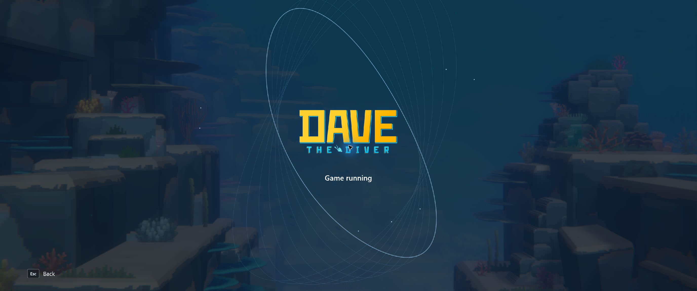

# Aniki Remake GPUI

A minimal fullscreen game launcher for Windows, built with Rust and GPUI. Browse your Playnite library, launch a game, and return to its Details page when you finish. **Playnite can stay closed.**

[Download v0.1](https://github.com/Skarian/aniki-remake-gpui/releases/tag/v0.1.0) · [Setup](#setup) · [Controls](#controls) · [Build from source](docs/development.md)


- Controller and keyboard navigation, with Xbox and PlayStation button prompts.
- Covers, backgrounds, logos, descriptions, music, trailers, and platform images from your Playnite library.
- Video playback up to 4K / 60 fps, when supported by your source media and display.
- A game-status screen stays behind the game. Closing the game returns you to Details; Back takes you Home.
- Works standalone or through Apollo/Moonlight.

## Setup

Requires **Windows x64**, a DirectX 11-capable GPU, and an existing **Playnite 10** installation with your games and integrations configured. The managed helpers use .NET Framework 4.x, as Playnite does.

1. Download `aniki-remake-gpui-v0.1.0-windows-x64.zip` from [Releases](https://github.com/Skarian/aniki-remake-gpui/releases/latest).
2. Extract the **whole folder** to a writable location. Keep `assets`, `importer`, and `tools` beside the executable.
3. Edit `aniki-remake-gpui.json`, beside `aniki-remake-gpui.exe`, with your Playnite paths.
4. Run `aniki-remake-gpui.exe`.

No Rust, SDL, FFmpeg installation, or separate native VC runtime installation is needed. The ZIP includes private media tools and our own helpers. **Playnite DLLs and storefront plugins are not bundled**; the launcher reads them from your installation.

The first start imports your library. Later starts use a local cache and refresh it in the background. Metadata and media are managed in Playnite; the launcher does not download missing artwork or edit your library.

### Portable Playnite

If Playnite's program, settings, and library are all in one folder:

```json
{
  "playnite_root": "D:\\Playnite",
  "fullscreen": true,
  "music": true,
  "video": true,
  "music_volume": 0.5,
  "ffmpeg": ""
}
```

### Separate program and data folders

```json
{
  "playnite_root": "C:\\Apps\\Playnite",
  "playnite_data_root": "C:\\Users\\YourName\\AppData\\Roaming\\Playnite",
  "playnite_library_path": "",
  "fullscreen": true,
  "music": true,
  "video": true,
  "music_volume": 0.5,
  "ffmpeg": ""
}
```

Use your actual paths, with doubled backslashes in JSON. The **program folder** contains `Playnite.SDK.dll`; the **data folder** contains `config.json` and `ExtensionsData`. Set `playnite_library_path` only if your library is elsewhere: it is the folder containing `games.db` and `files`. Empty values use the defaults. Environment variables such as `%APPDATA%` are not expanded.

Leave `ffmpeg` empty to use the included tools. `music_volume` ranges from `0` to `1`. More options are in [the example config](aniki-remake-gpui.example.json).

## Screenshots

**Details** — launch the game or watch its trailer.


**Game status** — this screen stays underneath the running game.



Screenshots show a configured personal library. Game artwork and videos are not included in the download and belong to their respective owners.

## Controls

| Action | Xbox | PlayStation | Keyboard |
| --- | --- | --- | --- |
| Browse / choose action | D-pad / left stick | D-pad / left stick | Arrow keys |
| Change collection | LB / RB | L1 / R1 | Q / E |
| Select / confirm | A | Cross | Enter |
| Back / Home menu | B / Start | Circle / Options | Escape / F1 |
| Music | X | Square | M |
| Watch video | Y | Triangle | V |
| Toggle fullscreen | | | F11 |

Keyboard and controller can be used in the same session. Xbox and virtual PS4 navigation have been tested; physical DualSense USB/Bluetooth coverage is still limited.

## Storefronts and limits

The plugin adapter recognizes **Steam, Epic, GOG, Xbox, Ubisoft, and Battle.net**. Install and configure their Playnite integrations first. Steam has real-game launch/return coverage; GOG has an actual-plugin action check. The other providers remain experimental. Explicit executable and emulator actions use native process tracking.

v0.1 does not include store login/import dialogs, library editing, downloads, achievements, playtime writeback, scripts, or multi-action/multi-ROM selection. Unsupported actions report an error. See [plugin hosting](docs/plugin-host.md) for the exact scope.

If a launch waits on a store prompt, press Back to uncover it. Cancelling a pending launch does not kill the game; a game that starts later may run untracked. An emulator process still running after its window closes remains tracked.

## Apollo / Moonlight

Use the full path to `aniki-remake-gpui.exe` as Apollo's command and its containing folder as the working directory. A cover is included at [`assets/apollo/aniki-remake-gpui-cover.png`](assets/apollo/aniki-remake-gpui-cover.png).

Fullscreen startup uses the Windows primary display. Set Apollo's streaming display as primary. Launching the app again activates the existing window and moves it to that display.

## Development and credits

[Build and test instructions](docs/development.md) · [Release workflow](docs/releases.md) · [Playnite behavior alignment](docs/playnite-alignment.md) · [Third-party notices](THIRD_PARTY_NOTICES.txt)

Inspired by Aniki's fullscreen presentation. Built with [GPUI](https://www.gpui.rs/) and [SDL](https://libsdl.org/), using [Playnite](https://playnite.link/) metadata and integrations. Input prompts are by [Meritite Union](https://github.com/meritite-union/input-prompts), CC0. This is an independent project, not an official Playnite or Aniki release.

The bundled FFmpeg build uses LGPL-2.1-or-later code and the BSD-licensed dav1d decoder. Matching source archives and build instructions accompany each binary release.
