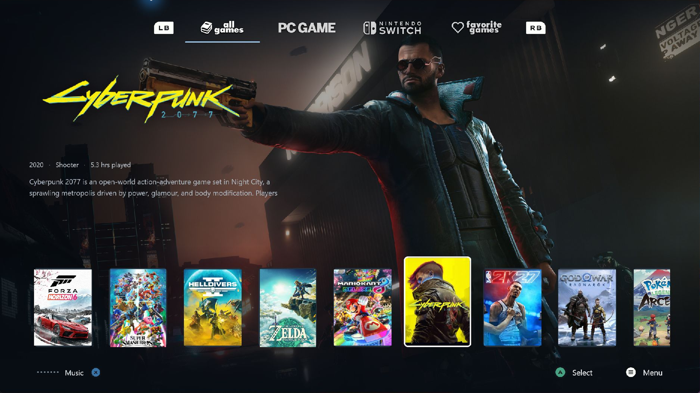
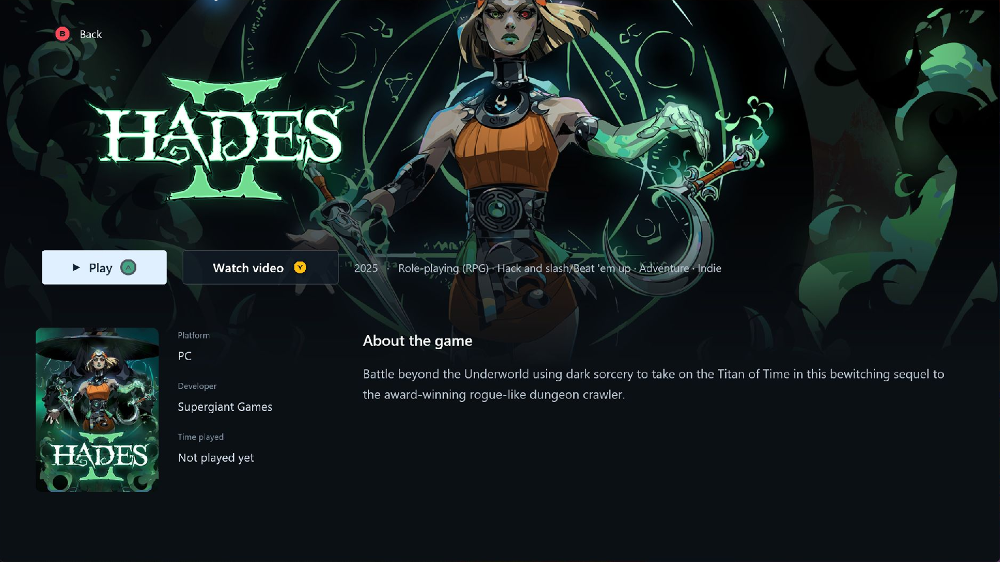

# Playnite Fullscreen GPUI

A fast, console-style fullscreen launcher for your Playnite library on Windows. Written in Rust with [GPUI](https://www.gpui.rs/), it starts in about 0.3 seconds and reads your Playnite library directly, so Playnite can stay closed.



[Download v0.1.0](https://github.com/Skarian/playnite-fullscreen-gpui/releases/tag/v0.1.0) · [Setup](#setup) · [Controls](#controls) · [Build from source](docs/development.md)

## Features

- **Fast startup.** The first frame appears about 0.3 seconds after launch in local benchmarks. See [benchmarks](docs/benchmarks.md).
- **Your Playnite library.** Covers, backgrounds, logos, descriptions, music, trailers and platform art come straight from Playnite. A local cache keeps startup fast, and library changes appear while the launcher is open.
- **Controller and keyboard.** Use Xbox controllers, PlayStation controllers and the keyboard together. Button prompts match the device you are using.
- **High-quality trailers.** Videos play at up to 4K and 60 fps, matching your source files and display.
- **A smooth game handoff.** A status screen stays behind the running game. Close the game and you are back on its Details page. Press B to go Home.
- **Your storefronts.** Steam, Epic, GOG, Xbox, Ubisoft and Battle.net games launch through your installed Playnite integrations. Emulators and executable actions work too.
- **Couch streaming.** Works standalone or as an Apollo/Moonlight app.




## Setup

You need Windows x64, a DirectX 11 GPU and Playnite 10 with your games and integrations set up.

1. Download `playnite-fullscreen-gpui-v0.1.0-windows-x64.zip` from [Releases](https://github.com/Skarian/playnite-fullscreen-gpui/releases/latest).
2. Extract the whole folder somewhere writable.
3. Open `playnite-fullscreen-gpui.json` and set your Playnite folder.
4. Run `playnite-fullscreen-gpui.exe`.

Everything else is in the ZIP, including FFmpeg. The launcher uses the Playnite and storefront DLLs from your own Playnite installation. The first start imports your library; later starts open from the cache.

### Configuration

Only `playnite_root` is required; everything else has a default. For a portable Playnite, where everything is in one folder:

```json
{
  "playnite_root": "D:\\Playnite"
}
```

For an installed Playnite, with program files and data in different folders:

```json
{
  "playnite_root": "C:\\Apps\\Playnite",
  "playnite_data_root": "C:\\Users\\YourName\\AppData\\Roaming\\Playnite"
}
```

| Setting | Meaning |
| --- | --- |
| `playnite_root` | Folder with `Playnite.SDK.dll`. |
| `playnite_data_root` | Folder with Playnite's `config.json` and `ExtensionsData`. Empty means `playnite_root`. |
| `playnite_library_path` | Folder with `games.db`, if you moved the library. Empty means `<data root>\library`. |
| `fullscreen`, `music`, `video` | Turn each on or off. |
| `music_volume` | `0` to `1`. Default `0.5`. |
| `ffmpeg` | Empty uses the included FFmpeg. |

Use full paths with doubled backslashes. An existing `aniki-remake-gpui.json` from an earlier download is still read if `playnite-fullscreen-gpui.json` is missing. The [example config](playnite-fullscreen-gpui.example.json) lists every option.

## Controls

| Action | Xbox | PlayStation | Keyboard |
| --- | --- | --- | --- |
| Move | D-pad / left stick | D-pad / left stick | Arrow keys |
| Change collection | LB / RB | L1 / R1 | Q / E |
| Select | A | Cross | Enter |
| Back | B | Circle | Escape |
| Menu (Home) | Start | Options | F1 |
| Music on/off | X | Square | M |
| Watch trailer | Y | Triangle | V |
| Fullscreen | | | F11 |

## Apollo / Moonlight

Add an app in Apollo with `playnite-fullscreen-gpui.exe` as the command and its folder as the working directory. Use [`assets/apollo/playnite-fullscreen-gpui-cover.png`](assets/apollo/playnite-fullscreen-gpui-cover.png) as the cover.

The launcher opens on the Windows primary display, so make Apollo's streaming display primary. Starting the app again brings the open launcher to that display.

## Good to know

- Library and media are managed in Playnite. The launcher reads them and leaves your library unchanged.
- v0.1 runs each game's Play action. Games that need Playnite scripts or a choice between several Play actions show an error, so launch those from Playnite. Store logins, library editing and playtime tracking also stay in Playnite.
- If a store shows a prompt during launch, press Back to reveal it.

## More

[Development](docs/development.md) · [Plugin host](docs/plugin-host.md) · [Playnite behavior](docs/playnite-alignment.md) · [Benchmarks](docs/benchmarks.md) · [Test history](docs/test-history.md) · [Releases](docs/releases.md) · [Third-party notices](THIRD_PARTY_NOTICES.txt)

Inspired by the Aniki ReMake fullscreen theme for Playnite. Built with [GPUI](https://www.gpui.rs/), [SDL](https://libsdl.org/) and [FFmpeg](https://ffmpeg.org/). Button prompts by [Meritite Union](https://github.com/meritite-union/input-prompts) (CC0). Playnite Fullscreen GPUI is an independent project, not affiliated with Playnite. Game artwork in the screenshots belongs to its owners and is not included.
